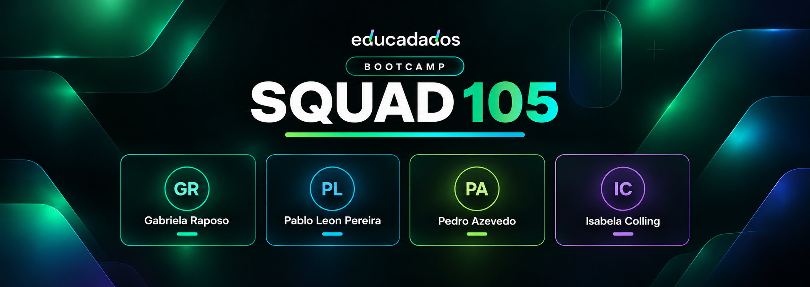

  

## Bootcamp Educadados

É uma jornada de aprendizagem prática e colaborativa em análise de dados e Business Intelligence, que integra formação técnica, resolução de desafios e desenvolvimento de projetos em equipe.

Ao longo de **seis fases**, os participantes aplicam seus conhecimentos em situações que simulam problemas reais de negócio, passando pela compreensão dos dados, modelagem, construção de indicadores e desenvolvimento de soluções analíticas.

A proposta é unir **conhecimento técnico, pensamento analítico e colaboração**, transformando dados em informações relevantes para a tomada de decisão.

## Nosso projeto

O **Squad 105** desenvolve suas atividades a partir do estudo de caso da **Rede Aurora Odontologia**, uma organização fictícia apresentada pela Educadados.

Este repositório reúne a documentação das seis fases do projeto, registrando desafios, metodologias, decisões técnicas e entregas realizadas pela equipe.

Cada fase possui sua própria documentação, permitindo acompanhar a evolução do projeto de forma clara e organizada.

## Integrantes

| Integrante | GitHub | LinkedIn |
|:--|:--|:--|
| **Gabriela Raposo** |  |  |
| **Pablo Leon Pereira** |  |  |
| **Pedro Azevedo** | A adicionar | A adicionar |
| **Isabela Colling** | A adicionar | A adicionar |

## Fases do Bootcamp

| Fase | Período oficial | Documentação |
|:--|:--|:--|
| **01 · Comercial** | 14–31 out 2026 | [Explorar Fase 01](fase-01/README.md) |
| **02** | 01–15 nov 2026 | [Explorar Fase 02](fase-02/README.md) |
| **03** | 16–30 nov 2026 | [Explorar Fase 03](fase-03/README.md) |
| **04** | 01–15 dez 2026 | [Explorar Fase 04](fase-04/README.md) |
| **05** | 16 dez 2026 – 05 jan 2027 | [Explorar Fase 05](fase-05/README.md) |
| **Final** | 06–29 jan 2027 | [Explorar Fase Final](fase-final/README.md) |

As próximas fases serão documentadas conforme seus desafios forem oficialmente disponibilizados.

## Tecnologias e ferramentas

**Dados e Business Intelligence**

**Desenvolvimento e colaboração**

As ferramentas fazem parte do percurso de aprendizagem e desenvolvimento do Squad. Cada fase documentará as tecnologias efetivamente utilizadas em sua execução.

## Materiais do case

Os arquivos, bases de dados e materiais de identidade visual da **Rede Aurora Odontologia** estão disponíveis nos recursos oficiais do projeto.

| Recurso | Acesso |
|:--|:--|
| **Base de dados e materiais de identidade visual** | [Google Drive](https://drive.google.com/drive/folders/1nLfQG5SabYKFH4ARgOyolPzSqRb2VVXc) |
| **Projeto original da logomarca** | [Figma](https://www.figma.com/design/RlCb3g2x0Ul6qalctSH0HV/Rede-Aurora-Odontologia-%E2%80%94-Logo?node-id=0-1&p=f) |

---

  Squad 105 · Bootcamp Educadados · 2026–2027
   
  Projeto estudantil

