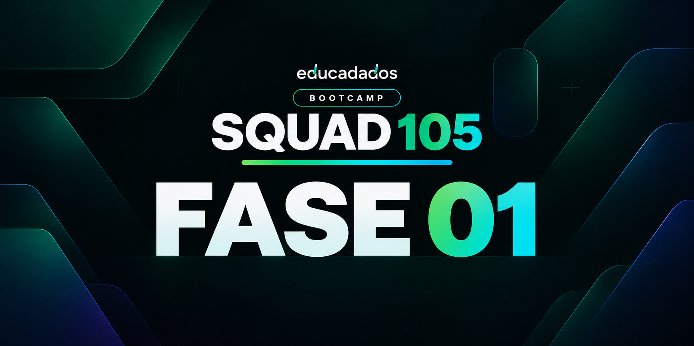

  

# Fase 01 · Comercial

**Quanto vendemos e se isso é bom ou ruim?**

**Período:** 14 a 31 de outubro de 2026

[← Voltar ao Squad 105](../README.md)

## Sobre o desafio

A primeira fase do Bootcamp Educadados tem como objetivo transformar dados comerciais em informações claras, confiáveis e úteis para a tomada de decisão.

O desafio consiste em analisar o desempenho das vendas, identificar resultados relevantes e compreender se as metas estabelecidas estão sendo alcançadas.

Para isso, utilizamos o estudo de caso da **Rede Aurora Odontologia**, uma empresa fictícia criada para o contexto do bootcamp.

  <picture>
    <source media="(prefers-color-scheme: dark)" srcset="../assets/aurora_branco_horizontal.png">
    
  </picture>

## Nosso objetivo

Desenvolver um **dashboard interativo no Power BI**, com até duas páginas, reunindo indicadores de vendas, metas e percentuais de atingimento.

A análise contempla sete perspectivas:

| Perspectiva | Análise |
|:--|:--|
| **Rede** | Desempenho geral e metas consolidadas |
| **Filiais** | Resultados por unidade |
| **Cidades** | Desempenho por localização |
| **Vendedores** | Vendas e metas individuais |
| **Profissionais** | Desempenho e metas individuais |
| **Grupos de serviço** | Valor bruto e quantidade de itens |
| **Serviços** | Resultados por serviço oferecido |

O relatório permitirá a análise por mês e ano, diferenciando valores líquidos e brutos, número de vendas e quantidade de itens, além de identificar os casos sem metas cadastradas.

## Base de dados

O projeto utiliza **11 planilhas Excel**, organizadas em três categorias:

- **Vendas:** `vendas` e `itens_venda`
- **Dimensões:** `filiais`, `cidades`, `vendedores`, `profissionais`, `servicos`, `grupos_servico` e `calendario`
- **Metas:** `metas_valor` e `metas_quantidade`

A preparação e a modelagem seguem o dicionário de dados disponibilizado no bootcamp.

## Desenvolvimento

O desenvolvimento está organizado em quatro etapas:

1. **Preparação:** importação, limpeza e transformação dos dados no Power Query.
2. **Modelagem:** organização das tabelas e seus relacionamentos.
3. **Indicadores:** criação de medidas e cálculos utilizando DAX.
4. **Visualização:** construção do dashboard no Power BI.

O relatório será dividido em uma **visão executiva** e uma **visão detalhada**, facilitando a interpretação dos resultados e a comparação com as metas.

## Entregáveis

| Entregável | Acesso |
|:--|:--|
| Dashboard interativo | Em desenvolvimento |
| Arquivo Power BI (`.pbix`) | Em desenvolvimento |

## Materiais oficiais

| Recurso | Acesso |
|:--|:--|
| **Bases de dados e identidade visual** | [Google Drive](https://drive.google.com/drive/folders/1nLfQG5SabYKFH4ARgOyolPzSqRb2VVXc) |
| **Projeto original da logomarca** | [Figma](https://www.figma.com/design/RlCb3g2x0Ul6qalctSH0HV/Rede-Aurora-Odontologia-%E2%80%94-Logo?node-id=0-1&p=f) |

---

  Squad 105 · Bootcamp Educadados · 2026–2027
   
  Projeto estudantil

