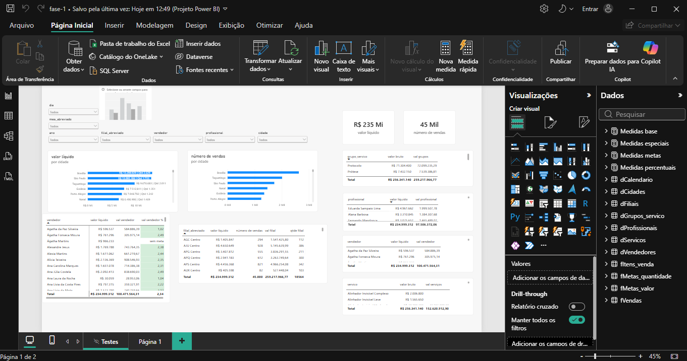

# Medidas

Esta documentação tem como objetivo salientar as medidas DAX criadas e seus comportamentos. Cada medida será apresentada da seguinte forma:

- o que ela busca obter
- código em DAX
- seu comportamento



As medidas foram divididas em quatro tópicos:

**Medidas base:** valor líquido, valor bruto, número de vendas, quantidade de itens, meta de valor e meta de quantidade.

**Medidas metas:** metas individuais por nível, metas da cidade e da rede.

**Medidas percentuais:** atingimentos individuais por nível, atingimentos da cidade,da filial e da rede.

**Medidas especiais:** rótulo especial e status da meta(individuais por nível,por filial, por cidade e por rede).

Segue a apresentação das medidas:

## Medidas base

### valor líquido

Calcula o valor líquido das vendas realizadas

```DAX
valor líquido = sum(fVendas[valor_liquido])
```

### número de vendas

Calcula a quantidade de vendas realizadas

```DAX
número de vendas = DISTINCTCOUNT(fVendas[codigo_venda])
```

**Importante:** Essa duas medidas DAX não funcionaram num contexto de linha que tenha atributos das tabelas dservicos e dgrupos_servico. Já que fvendas não se relaciona diretamente com essas tabelas.

### valor bruto

Calcula o valor bruto dos produtos vendidos

```DAX
valor bruto = sum(fItens_venda[valor_total])
```

### quantidade de itens

Calcula a quantidade de itens vendidos

```DAX
quantidade de itens = sum(fItens_venda[quantidade])
```

### meta de valor

Calcula as metas de valor líquido

```DAX
meta de valor = sum(fMetas_valor[meta_valor])
```

### meta de quantidade

Calcula as metas de quantidade de itens vendidos

```DAX
meta de quantidade = sum(fMetas_quantidade[meta_quantidade])
```

## Medidas metas

### val vendedor

Calcula a meta de valor no nível de vendedor

```DAX
val vendedor = CALCULATE([meta de valor], fMetas_valor[nivel] = "Vendedor")
```

### val profissional

Calcula a meta de valor no nível de profissional

```DAX
val profissional = CALCULATE([meta de valor], fMetas_valor[nivel] = "Profissional")
```

### val grupos

Calcula a meta de valor no nível de produto

```DAX
val grupos = CALCULATE([meta de valor], 
USERELATIONSHIP(dGrupos_servico[codigo_grupo_servico], fMetas_valor[codigo_grupo_servico]), 
fMetas_valor[nivel] = "Produto")
```

### val serviços

Calcula a meta de valor no nível de serviço

```DAX
val serviços = CALCULATE([meta de valor], 
USERELATIONSHIP(dServicos[codigo_servico], fMetas_valor[codigo_servico]), 
fMetas_valor[nivel] = "Serviço")
```

### val filial

Calcula a meta de valor de filial no nível de produto

```DAX
val filial = CALCULATE([meta de valor],
fMetas_valor[nivel] = "Produto")
```

### val cidade

Calcula a meta de valor da cidade somando as filiais dela

```DAX
val cidade = calculate([val filial], 
REMOVEFILTERS(dFiliais[filial],
dFiliais[regional], 
dFiliais[filial_abreviado]),
REMOVEFILTERS( dVendedores[vendedor]),
REMOVEFILTERS(dProfissionais[profissional]))
```

### val rede

Calcula a meta de valor da rede somando as metas de valor das filiais

```DAX
val rede = calculate([val filial], 
REMOVEFILTERS(dFiliais[filial],
dFiliais[regional], 
dFiliais[filial_abreviado]),
REMOVEFILTERS( dVendedores[vendedor]),
REMOVEFILTERS(dProfissionais[profissional]),
REMOVEFILTERS(dCidades[cidade],
dCidades[uf],
dCidades[regiao],
dCidades[estado]))
```

### qtde vendedor

Calcula a meta de quantidade no nível de vendedor

```DAX
qtde vendedor = CALCULATE([meta de quantidade], fMetas_quantidade[nivel] = "Vendedor")
```

### qtde profissional

Calcula a meta de quantidade no nível de profissional

```DAX
qtde profissional = CALCULATE([meta de quantidade], fMetas_quantidade[nivel] = "Profissional")
```

### qtde grupos

Calcula a meta de quantidade no nível de produto

```DAX
qtde grupos = CALCULATE([meta de quantidade], 
USERELATIONSHIP(dGrupos_servico[codigo_grupo_servico], fMetas_quantidade[codigo_grupo_servico]), 
fMetas_quantidade[nivel] = "Produto")
```

### qtde serviços

Calcula a meta de quantidade no nível de serviço

```DAX
qtde serviços = CALCULATE([meta de quantidade], 
USERELATIONSHIP(dServicos[codigo_servico], fMetas_quantidade[codigo_servico]), 
fMetas_quantidade[nivel] = "Serviço")
```

### qtde filial

Calcula a meta de quantidade de filial no nível de vendedor

```DAX
qtde filial = CALCULATE([meta de quantidade],
fMetas_quantidade[nivel] = "Vendedor")
```

### qtde cidade

Calcula a meta de quantidade da cidade somando as metas de quantidade das filiais dela

```DAX
qtde cidade = calculate([qtde filial], 
REMOVEFILTERS(dFiliais[filial],
dFiliais[regional], 
dFiliais[filial_abreviado]),
REMOVEFILTERS( dVendedores[vendedor]),
REMOVEFILTERS(dProfissionais[profissional]))
```

### qtde rede

Calcula a meta de quantidade da rede somando as metas de quantidade das filiais

```DAX
qtde rede = calculate([qtde filial], 
REMOVEFILTERS(dFiliais[filial],
dFiliais[regional], 
dFiliais[filial_abreviado]),
REMOVEFILTERS( dVendedores[vendedor]),
REMOVEFILTERS(dProfissionais[profissional]),
REMOVEFILTERS(dCidades[cidade],
dCidades[uf],
dCidades[regiao],
dCidades[estado]))
```

## Medidas Percentuais

### val vendedor %

Calcula o percentual de atingimento da meta de valor no nível de vendedor

```DAX
val vendedor % = divide(
    [valor líquido],
    [val vendedor],
    "sem meta")
```

### val profissional %

Calcula o percentual de atingimento da meta de valor no nível de profissional

```DAX
val profissional % = divide(
    [valor líquido],
    [val profissional],
    "sem meta")
```

### val grupos %

Calcula o percentual de atingimento da meta de valor no nível de produto

```DAX
val grupos % = divide(
    [valor bruto],
    [val grupos],
    "sem meta")
```

### val serviços %

Calcula o percentual de atingimento da meta de valor no nível de serviço

```DAX
val serviços % = divide(
    [valor bruto],
    [val serviços],
    "sem meta")
```

### val cidade %

Calcula o percentual de atingimento da meta de valor da cidade

```DAX
val cidade % = divide(
    [valor líquido],
    [val cidade],
    "sem meta")
```

### val filial %

Calcula o percentual de atingimento da meta de valor da filial

```DAX
val filial % = divide(
    [valor líquido],
    [val filial],
    "sem meta")
```

### val rede %

Calcula o percentual de atingimento da meta de valor da rede

```DAX
val rede % = divide(
    [valor líquido],
    [val rede],
    "sem meta")
```

### qtde vendedor %

Calcula o percentual de atingimento da meta de quantidade no nível de vendedor

```DAX
qtde vendedor % = divide(
    [número de vendas],
    [qtde vendedor],
    "sem meta")
```

### qtde profissional %

Calcula o percentual de atingimento da meta de quantidade no nível de profissional

```DAX
qtde profissional % = divide(
    [número de vendas],
    [qtde profissional],
    "sem meta")
```

### qtde grupos %

Calcula o percentual de atingimento da meta de quantidade no nível de produto

```DAX
qtde grupos % = divide(
    [quantidade de itens],
    [qtde grupos],
    "sem meta")
```

### qtde serviços %

Calcula o percentual de atingimento da meta de quantidade no nível de serviços

```DAX
qtde serviços % = divide(
    [quantidade de itens],
    [qtde serviços],
    "sem meta")
```

### qtde cidade %

Calcula o percentual de atingimento da meta de quantidade da cidade

```DAX
qtde cidade % = divide(
    [número de vendas],
    [qtde cidade],
    "sem meta")
```

### qtde filial %

Calcula o percentual de atingimento da meta de quantidade da filial

```DAX
qtde filial % = divide(
    [número de vendas],
    [qtde filial],
    "sem meta")
```

### qtde rede %

Calcula o percentual de atingimento da meta de quantidade da rede

```DAX
qtde rede % = divide(
    [número de vendas],
    [qtde rede],
    "sem meta")
```

## Medidas especiais

Medidas DAX criadas com o intuito de atender requisitos pedidos nos visuais

### Rótulo especial

Atender ao rótulo de dados especial pedido para ser incluido nos gráficos de cidade e de filial

```DAX
rótulo especial = 
var valFormat = SWITCH(true(),
[valor líquido] > 999999999, format([valor líquido], "#\.###\.###\.###"),
[valor líquido] > 999999, format([valor líquido], "#\.###\.###"),
[valor líquido] > 999, format([valor líquido], "#\.###"),
format([valor líquido], "###"))
var qtdeFormat = if([número de vendas] > 999, format([número de vendas], "#\.###"), format([número de vendas], "###"))
return "R$ " & valformat & " | Qtd " & qtdeformat
```

Essa medida retorna um rótulo dinâmico

### status val vendedor

Medida DAX criada para atender a exigência de formatação das cores na matriz de vendedor no coluna de atingimento da meta de valor

```DAX
status val vendedor = CALCULATE( SWITCH(true(),
[val vendedor %] = "sem meta","FFFFFF",
[val vendedor %] > 1, "#D4EDDA",
[val vendedor %] < 1, "#F8D7DA"), fMetas_valor[nivel] = "Vendedor")
```

### status qtde vendedor

Medida DAX também criada para atender a exigência de formatação das cores na matriz de vendedor no coluna de atingimento da meta de quantidade

```DAX
status qtde vendedor = CALCULATE( SWITCH(true(),
[qtde vendedor %] = "sem meta","FFFFFF",
[qtde vendedor %] > 1, "#D4EDDA",
[qtde vendedor %] < 1, "#F8D7DA"), fMetas_quantidade[nivel] = "Vendedor")
```

### status val profissional

Medida DAX criada para atender a exigência de formatação das cores na matriz de profissional no coluna de atingimento da meta de valor

```DAX
status val profissional = CALCULATE( SWITCH(true(),
[val profissional %] = "sem meta","FFFFFF",
[val profissional %] > 1, "#D4EDDA",
[val profissional %] < 1, "#F8D7DA"), fMetas_valor[nivel] = "Profissional")
```

### status qtde profissional

Medida DAX também criada para atender a exigência de formatação das cores na matriz de profissional no coluna de atingimento da meta de quantidade

```DAX
status qtde profissional = CALCULATE( SWITCH(true(),
[qtde profissional %] = "sem meta","FFFFFF",
[qtde profissional %] > 1, "#D4EDDA",
[qtde profissional %] < 1, "#F8D7DA"), fMetas_quantidade[nivel] = "Profissional")
```

Essas medidas de status retornam o hexadecimal da cor verde para acima da meta, vermelho para baixo e cinza para sem meta.

Essas medidas foram feitas para serem utilizadas como valor de campo.

---

## Testes e Validações

Todas as medidas foram testadas no visuais solicitados e apresentaram os comportamentos esperados. Não entrarei em detalhes pela extensão mas garanto que as medidas DAX são confiáveis.

Os testes realizados ainda podem ser visualizados na página oculta e temporária `testes`.