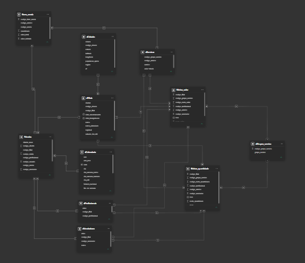
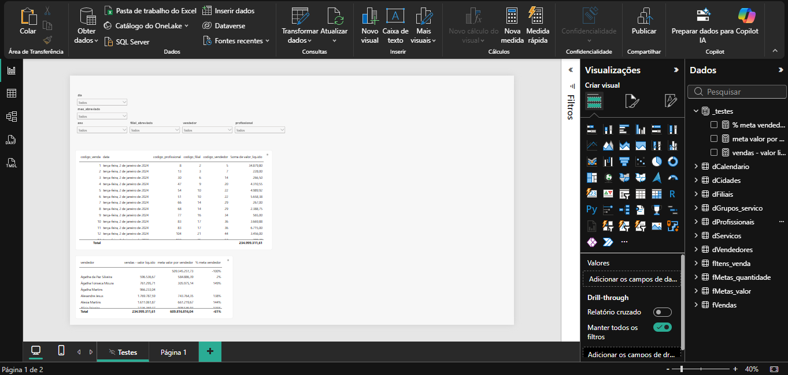

# Modelagem

Esta documentação apresentará os relacionamentos entre as tabelas com suas particularidades e os testes realizados para validar o modelo escolhido.



Os relacionamentos foram baseados nas chaves estrangeiras identificadas na fase de [Power Query](power_query.md). As relações serão mostradas da seguinte forma:

| Tabela (Estrangeira) | Coluna (Estrangeira) | Cardinalidade | Tabela (Primária) | Coluna (Primária) | Status |
| --- | --- | --- | --- | --- | --- |
| Tabela A | Coluna 1 | N --- 1 | Tabela B | Coluna 2 | Ativo |

---

### Relacionamentos

| Tabela (Estrangeira) | Coluna (Estrangeira) | Cardinalidade | Tabela (Primária) | Coluna (Primária) | Status |
| --- | --- | --- | --- | --- | --- |
| dFiliais | codigo_cidade | N --- 1 | dCidades | codigo_cidade | Ativo |
| dProfissionais | codigo_filial | N --- 1 | dFiliais | codigo_filial | Inativo |
| dServicos | codigo_grupo_servico | N --- 1 | dGrupos_servico | codigo_grupo_servico | Ativo |
| dVendedores | codigo_filial | N --- 1 | dFiliais | codigo_filial | Inativo |
| fItens_venda | codigo_servico | N --- 1 | dServicos | codigo_servico | Ativo |
| fItens_venda | codigo_venda | N --- 1 | fVendas | codigo_venda | Ativo |
| fMetas_quantidade | codigo_filial | N --- 1 | dFiliais | codigo_filial | Ativo |
| fMetas_quantidade | codigo_grupos_servico | N --- 1 | dGrupos_servico | codigo_grupos_servico | Inativo |
| fMetas_quantidade | codigo_profissional | N --- 1 | dProfissionais | codigo_profissional | Ativo |
| fMetas_quantidade | codigo_servico | N --- 1 | dServicos | codigo_servico | Inativo |
| fMetas_quantidade | codigo_vendedor | N --- 1 | dVendedores | codigo_vendedor |Ativo |
| fMetas_quantidade | mes | N --- 1 | dCalendario | data | Ativo |
| fMetas_valor | codigo_filial | N --- 1 | dFiliais | codigo_filial | Ativo |
| fMetas_valor | codigo_grupos_servico | N --- 1 | dGrupos_servico | codigo_grupos_servico | Inativo |
| fMetas_valor | codigo_profissional | N --- 1 | dProfissionais | codigo_profissional | Ativo |
| fMetas_valor | codigo_servico | N --- 1 | dServicos | codigo_servico | Inativo |
| fMetas_valor | codigo_vendedor | N --- 1 | dVendedores | codigo_vendedor | Ativo |
| fMetas_valor | mes | N --- 1 | dCalendario | data | Ativo |
| fVendas | codigo_filial | N --- 1 | dFiliais | codigo_filial | Ativo |
| fVendas | codigo_profissional | N --- 1 | dProfissionais | codigo_profissional | Ativo | 
| fVendas | codigo_vendedor | N --- 1 | dVendedores | codigo_vendedor | Ativo |
| fVendas | data | N --- 1 | dCalendario | data | Ativo |

---

#### Relações inativas

Algumas relações foram mantidas inativas com o intuito de priorizar caminhos diretos, evitando caminhos alternativos por questões de custo. Por exemplo:

**Caminho direto**
```
dFiliais -> fVendas
```

**Caminho alternativo**
```
dFiliais -> dProfissionais -> fVendas
```

---

#### Como usar relações inativas

As relações inativas são utilizadas por meio de `USERELATIONSHIP()` em medidas DAX, permitindo selecionar explicitamente o caminho de filtro necessário para cada cálculo.

É possível utilizar múltiplas chamadas de `USERELATIONSHIP()` na mesma medida, desde que as relações sejam compatíveis com o comportamento esperado. Entretanto, deve-se evitar ativar relações que criem caminhos de filtro concorrentes, especialmente entre dGrupos_servico, dServicos e as tabelas de metas.

Para as metas, as relações devem ser ativadas conforme o nível analisado — grupo de serviço, serviço, vendedor ou profissional —, preservando a coerência dos filtros e evitando a mistura de classificações distintas.

```DAX
CALCULATE(
    [Medida],
    USERELATIONSHIP(Tabela1[Coluna], Tabela2[Coluna])
)
```

---

### Testes e validações



Inicialmente, foi verificado se todas as chaves primárias são únicas e cobrem todas as chaves estrangeiras a seguir foi criado uma página `Testes` afim de realizar as validações. É uma tabela `_testes` para organizar as medidas. Em seguida, foi realizada a verifição dos filtros na `fVendas` através de segmentadores. Por fim, foi testado o uso do `USERELATIONSHIP()` em metas.

O modelo passou com louvor em todas as etapas!