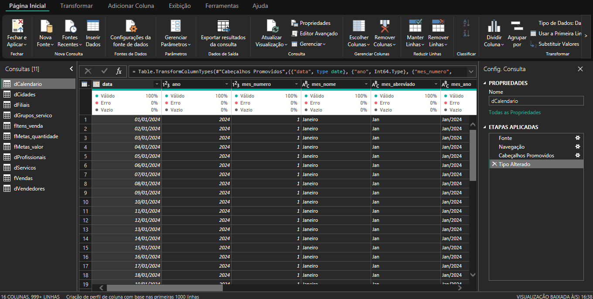

# Power Query

Esta documentação irá apresentar as colunas e o tipo de dado atribuído a cada uma delas, com o intuito de facilitar a criação de medidas e indicadores.

As tabelas são mostradas sequencialmente em ordem alfabética para cada tabela será mostrada n colunas com 2 linhas, em que a linha de cima serão apresentados os nomes das colunas e na linha de baixo serão mostrados os tipos de dados. Abaixo um modelo de como cada tabela será apresentada:

### Nome da tabela

| Coluna 1 | Coluna 2 | Coluna 3 |
| --- | --- | --- |
| Tipo de dado 1 | Tipo de dado 2 | Tipo de dado 3 |

> **informações:**
>
> conterá informações importantes sobre a tabela como (chave primária, chave estrangeira, pontos de atenção, etc)

> **glossário:** antes do nome de cada tabela haverá uma letra `d` ou `f`:
>- `f`: sinaliza que aquela é uma tabela fato.
>- `d`: sinaliza que aquela é uma tabela dimensão.

> **observação:** a tipagem de dados para cada coluna e os nomes das colunas segue o dicionário de dados repassado pelo educadados.

---

### dCalendario

| data | ano | mes_numero | mes_nome | mes_abreviado | mes_ano | ano_mes | trimestre | semana_do_ano | dia | dia_semana_numero | dia_semana_nome | fim_de_semana | feriado_nacional | dia_util |
|  --- | --- | --- | --- | --- | --- | --- | --- | --- | --- | --- | --- | --- | --- | --- |
| data | inteiro | inteiro | texto | texto | texto | texto | inteiro | inteiro | inteiro | inteiro | texto | verdadeiro/falso | verdadeiro/falso |

> **informações:** 
>
> chave primária: data

---

### dCidades

| codigo_cidade | cidade | uf | estado | regiao | latitude | longitude | populacao_aprox |
| --- | --- | --- | --- | --- | --- | --- | --- |
| inteiro | texto | texto | texto | texto | decimal | decimal | inteiro |

> **informações:**
>
> chave primária: codigo_cidade

---

### dFiliais

| codigo_filial | nome | nome_abreviado | codigo_cidade | regional | cluster | sabado_dia_util | unidade_ativa | data_inauguracao | data_encerramento |
| --- | --- | --- | --- | --- | --- | --- | --- | --- | --- |
| inteiro | texto | texto | inteiro | texto | texto | texto | texto | data | data |

> **informações:**
>
> chave primária: codigo_filial
>
> chave estrangeira: codigo_cidade [dCidades]
>
> **atenção:** na coluna `data_encerramento` alguns valores nulos apareceram, isso é normal são unidades que ainda não foram desativadas.

---

### dGrupos_servico

| codigo_grupo_servico | grupo_servico |
| --- | --- |
| inteiro | texto |

> **informações:**
>
> chave_primária: codigo_grupo_servico

---

### fItens_venda

| codigo_item_venda | codigo_venda | codigo_servico | quantidade | valor_unitario | valor_total |
| --- | --- | --- | --- | --- | --- |
| inteiro | inteiro | inteiro | inteiro | decimal | decimal|

> **informações:**
>
> chave_primária: codigo_item_venda
>
> chaves estrangeiras:
> - codigo_venda [fVendas]
> - codigo_servico [dServicos]

---

### fMetas_quantidade

| codigo_meta_quantidade | codigo_filial | mes | nivel | codigo_grupo_servico | codigo_servico | codigo_vendedor | codigo_profissional | meta_quantidade |
| --- | --- | --- | --- | --- | --- | --- | --- | --- |
| inteiro | inteiro | data | texto | inteiro | inteiro | inteiro | inteiro | inteiro | 

> **informações:**
>
> chave_primária: codigo_meta_quantidade
>
> chaves estrangeiras:
> - mes [dCalendario]
> - codigo_filial [dFiliais]
> - codigo_grupo_servico [dGrupos_servico]
> - codigo_servico [dServicos]
> - codigo_vendedor [dVendedores]
> - codigo_profissional [dProfissionais]
>
> **atenção:** nas colunas `codigo_grupo_servico, codigo_servico, codigo_vendedor` e ` codigo_profissional` aparecem valores nulos, o comportamento esperado era que para cada tupla se uma coluna está preenchida as outras devem estar nulas, e esse foi o comportamento obtido.

---

### fMetas_valor

| codigo_meta_valor | codigo_filial | mes | nivel | codigo_grupo_servico | codigo_servico | codigo_vendedor | codigo_profissional | meta_valor |
| --- | --- | --- | --- | --- | --- | --- | --- | --- |
| inteiro | inteiro | data | texto | inteiro | inteiro | inteiro | inteiro | decimal | 

> **informações:**
>
> chave primária: codigo_meta_valor
>
> chaves estrangeiras:
> - mes [dCalendario]
> - codigo_filial [dFiliais]
> - codigo_grupo_servico [dGrupos_servico]
> - codigo_servico [dServicos]
> - codigo_vendedor [dVendedores]
> - codigo_profissional [dProfissionais]
>
> **atenção:** mesmo comportamento da tabela anterior.

---

### dProfissionais

| codigo_profissional | nome | especialidade | codigo_filial | ativo |
| --- | --- | --- | --- | --- |
| inteiro | texto | texto | inteiro | verdadeiro/falso |

> **informações:**
>
> chave primária: codigo_profissional
>
> chave estrangeira: codigo_filial[dFiliais]

---

### dServicos

| codigo_servico | servico | codigo_grupo_servico | valor_tabela |
| --- | --- | --- | --- |
| inteiro | texto | inteiro | decimal |

> **informações:**
>
> chave primária: codigo_servico
>
> chave estrangeira: codigo_grupo_servico[dGrupos_servico]

---

### fVendas

| codigo_venda | data | codigo_filial | codigo_cliente | codigo_profissional | codigo_vendedor | codigo_usuario | codigo_midia | valor_bruto | valor_desconto | valor_liquido | forma_pagamento | cliente_novo |
| --- | --- | --- | --- | --- | --- | --- | --- | --- | --- | --- | --- | --- |
| inteiro | data | inteiro | inteiro | inteiro | inteiro | inteiro | inteiro | decimal | decimal | decimal | texto | texto |

> **informações:**
>
> chave primária: codigo_venda
>
> chaves estrangeiras:
> - data [dCalendario]
> - codigo_filial [dFiliais]
> - codigo_profissional [dProfissionais]
> - codigo_vendedor [dVendedores]

---

### dVendedores

| codigo_vendedor | nome | codigo_filial | ativo |
| --- | --- | --- | --- |
| inteiro | texto | inteiro | verdadeiro/falso |

> **informações:**
>
> chave primária: codigo_vendedor
>
> chave estrangeira: codigo_filial [dFiliais]

---