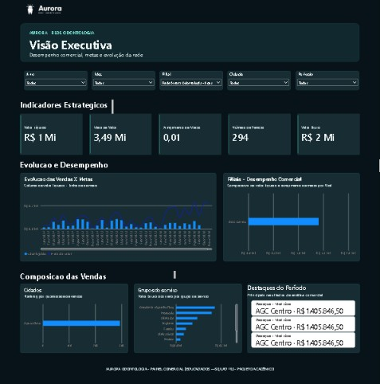
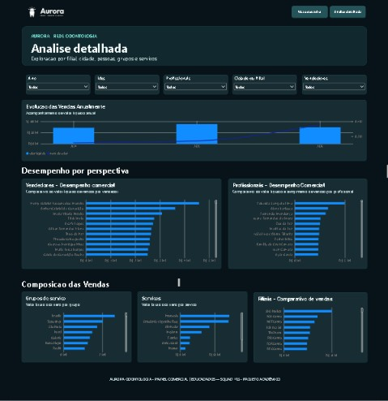

# Documentacao de Testes (QA) 

## 1. Matriz de Casos de Teste

| ID do Teste | Item / Regra de Negocio | Objetivo do Teste | Status | Evidencia |
| :--- | :--- | :--- | :---: | :--- |
| **CT-00** | Requisitos Visuais da Cliente | Validar a presenca e formatacao dos 8 elementos visuais solicitados | [x] | `Aprovado (8/8 visuais)` ([Ver Print](#visao-executiva)) |
| **CT-01** | Valor Liquido da Rede | Validar o valor liquido total consolidado da rede | [x] | `Aprovado — R$ 234.999.312` ([Ver Print](#visao-executiva)) |
| **CT-02** | Maior Valor Liquido vs. Atingimento | Verificar se o maior valor liquido corresponde ao maior atingimento | [x] | `Reprovado — SAO Paulista tem o maior valor líquido (R$ 10.018.608,79 - 90,1% de meta), mas o maior atingimento é da SBD Centro (105,1%)` ([Ver Print](#visao-executiva)) |
| **CT-03** | Cidade Lider em Vendas | Visual de cidades ordenados corretamente por valor | [x] | `Aprovado — São Paulo com R$ 14.557.742,69 seguindo a métrica valor cidade e Brasília com R$ 13.298.929 seguindo a métrica valor líquido` ([Ver Print](#visao-executiva)) |
| **CT-04** | Vendedor com Menor Atingimento | Identificar o vendedor com menor % de atingimento (considerando Meta > 0) | [x] | `Aprovado — Juan Sampaio` ([Ver Print](#analise-detalhada)) |
| **CT-05** | Grupo de Servico Lider | Identificar o grupo de servico lider em valor bruto e seu % do total | [] | `Aprovado — Protocolo (27,81%)` ([Ver Print](#analise-detalhada)) |
| **CT-06** | Inspecao de Erros no Power Query | Validar tipos de dados, nulos e inconsistencias na carga | [] | `Aprovado (Zero erros de carga)` |
| **CT-07** | Requisicao de Homologacao | Registrar e acompanhar a correcao dos bugs identificados | [x] | `Aprovado (Sem bugs abertos)` |
| **CT-08** | Exportacao e Envio por E-mail | Validar exportacao em PDF dos endpoints e envio das informacoes | [] | `Aprovado (PDF gerado e enviado)` |
| **CT-09** | Navegacao e Filtros das Paginas | Testar navegacao entre as 2 paginas, botoes, marcadores e fatiadores | [] | `Aprovado (7 fatiadores operacionais)` ([Ver Print](#analise-detalhada)) |

---

## 2. Detalhamento dos Testes Executados

### CT-00: Validacao de Requisitos Visuais e Layout (Entregaveis da Cliente)
- [x] **1. Cartoes no Topo:** Valor liquido, qtd vendas, meta valor, meta qtd e % de atingimento de cada.
- [x] **2. Grafico por Filial:** Barras horizontais ordenadas com rotulo no formato "R$ XX | Qtd YY".
- [x] **3. Grafico por Cidade:** Top 10 cidades com rotulo combinado (Valor | Qtd).
- [x] **4. Grafico por Grupo de Servico:** Colunas com rotulo e linha representando a meta.
- [x] **5. Matriz por Vendedor:** Colunas de valor, meta, %, qtd, meta qtd, % + formatacao condicional.
- [x] **6. Matriz por Profissional:** Mesmas colunas da matriz de vendedores.
- [x] **7. Tabela por Servico:** Exibicao de valor, qtd, meta e texto "sem meta" onde aplicavel.
- [x] **8. Navegacao e Filtros:** Segmentadores de Mes/Ano e botoes/parametros para os cortes de navegacao.

### CT-01: Validacao do Valor Liquido da Rede
* **Objetivo:** Conferir o total consolidado do Valor Liquido no card principal.
* **Resultado Esperado:** O valor deve bater com a soma da coluna de Valor Liquido na base de dados tratada.
* **Resultado Obtido:** R$ [Preencher Valor]
* **Status:** ...

### CT-02: Maior Valor Liquido vs. Atingimento de Meta
* **Objetivo:** Identificar a categoria com maior valor liquido e conferir seu percentual de atingimento.
* **Resultado Esperado:** Confirmar se o maior faturamento liquido e tambem a maior taxa de meta atingida.
* **Resultado Obtido:** Categoria: [Nome] | Valor: R$ [Valor] | Atingimento: [Percentual]%
* **Status:** ...

### CT-03: Cidade Lider em Vendas
* **Objetivo:** Identificar a cidade top 1 em quantidade de vendas e extrair o seu valor financeiro.
* **Resultado Esperado:** Visual de cidades ordenado corretamente por volume.
* **Resultado Obtido:** Cidade: [Nome da Cidade] | Qtd Vendas: [Quantidade] | Valor: R$ [Valor]
* **Status:** ...

### CT-04: Vendedor com Menor Atingimento de Meta
* **Objetivo:** Identificar o vendedor com menor % de atingimento de meta, filtrando apenas vendedores com Meta > 0.
* **Resultado Esperado:** Exclusao de vendedores sem meta da analise de menor atingimento.
* **Resultado Obtido:** Vendedor: [Nome] | Meta: R$ [Valor] | Realizado: R$ [Valor] | Atingimento: [Percentual]%
* **Status:** ...

### CT-05: Grupo de Servico Lider
* **Objetivo:** Identificar o grupo de servico com maior valor bruto e sua participacao percentual no total.
* **Resultado Esperado:** Percentual relativo calculado corretamente sobre o faturamento bruto total.
* **Resultado Obtido:** Grupo: [Nome] | Valor Bruto: R$ [Valor] | Participacao: [Percentual]%
* **Status:** ...

### CT-09: Teste de Navegacao e Interatividade
* **Objetivo:** Garantir a funcionalidade das 2 paginas, botoes de navegacao, marcadores e fatiadores de dados.
* **Resultado Esperado:** Todos os botoes devem redirecionar corretamente e os filtros devem refletir em todos os visuais da pagina.
* **Status:** ...
---

## 3. Log de Inconsistencias (Bugs)

| ID Bug | Descricao da Inconsistencia | Origem (ETL / DAX / Visual) | Severidade | Status |
| :--- | :--- | :--- | :--- | :--- |
| **BUG-01** | [] |  |   |    |

## 4. Registro de Evidências Finais

### Resumo dos Indicadores Validados
* **Valor Líquido Total da Rede:** [ Valor Líquido Total]
* **Cidade Líder em Volume:** [ Nome da Cidade] ([ Qtd de Vendas] vendas | [Valor Total])
* **Vendedor com Menor Atingimento:** [ Nome do Vendedor] ([ Valor Realizado])
* **Grupo de Serviço Líder:** [ Nome do Grupo] ([Valor Bruto] | [ % do Total])
* **Status da Homologação:** 100% Aprovado (Zero inconsistências ou bugs pendentes)

---

### Evidências Visuais do Painel

#### Página 1 — Visão Executiva

#### Página 2 — Análise Detalhada
