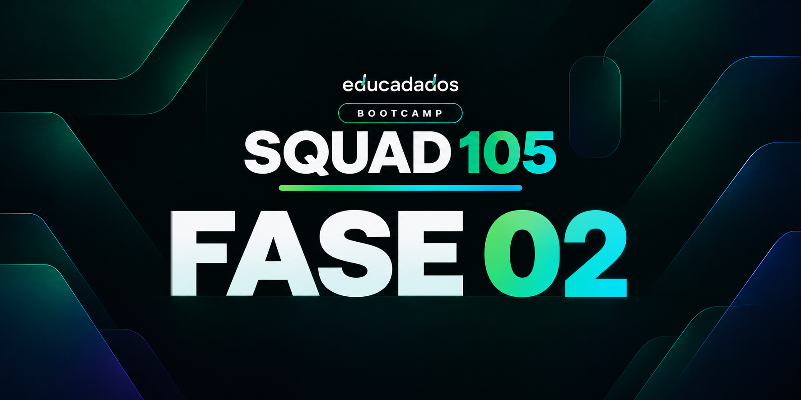

  

# Fase 02 · Atingimento

**Quem atingiu, quem não atingiu e o que vende dentro de cada grupo?**

**Período:** 08 a 23 de novembro de 2026

[← Voltar ao Squad 105](../README.md)

## Sobre o desafio

A segunda fase do Bootcamp Educadados evolui o painel construído na Fase 01 para uma **ferramenta de decisão**.

Na reunião mensal de resultados, a diretoria da rede percebeu que os números já estavam visíveis, mas faltava enxergar com clareza **quem bateu a meta e quem não bateu**, e entender por que uma unidade pode vender bem e, ainda assim, ficar abaixo do esperado.

O desafio consiste em destacar o atingimento de metas, analisar o funil de orçamentos de cada filial e detalhar as vendas por grupo de serviço e por serviço.

Seguimos com o estudo de caso da **Rede Aurora Odontologia**, empresa fictícia criada para o contexto do bootcamp.

  
  

## Nosso objetivo

Evoluir o **dashboard no Power BI** para que o atingimento das metas fique evidente à primeira vista e para que seja possível investigar as causas por trás dos resultados.

A análise contempla cinco frentes:

| Frente | Análise |
|:--|:--|
| **Atingimento** | Quem atingiu e quem não atingiu a meta, em valor e em quantidade, de forma separada |
| **Faixas** | Classificação do atingimento em abaixo de 90%, de 90% a 99% e 100% ou mais |
| **Orçamentos** | Funil por filial: gerados, aprovados, perdidos, taxa de conversão, desconto médio e valor perdido |
| **Grupos e serviços** | Matriz grupo › serviço com % do total da rede e % dentro do grupo (cada grupo fecha 100%) |
| **Sem meta** | Página de alerta, no formato de tela de erro, com quem não tem meta cadastrada para 2026 |

O relatório terá segmentações de **ano, mês e filial**, deixando explícitos os casos em que uma unidade bate a meta de valor e não a de quantidade, ou o contrário.

## Visuais previstos

| Visual | Descrição |
|:--|:--|
| **Matriz de atingimento por filial** | Valor, meta e % de atingimento de valor e de quantidade lado a lado, com ícones ou cores por faixa |
| **Funil de orçamentos** | Gerados, aprovados e perdidos, com a taxa de conversão no rótulo |
| **Conversão por filial** | Gráfico de barras com a média da rede como linha de referência |
| **Matriz grupo › serviço** | Valor, % do total da rede e % dentro do grupo, com barras de dados na coluna de valor |
| **Cartões de resumo** | Filiais em cada faixa de atingimento, desconto médio concedido e valor perdido em orçamentos |
| **Página de alerta** | Lista de quem não tem meta para 2026, com filial, situação e vendas no ano |

## Base de dados

O projeto passa a utilizar **12 planilhas Excel**, com a inclusão da base de orçamentos:

- **Vendas:** `vendas` e `itens_venda`
- **Orçamentos:** `orcamentos` *(novo nesta fase)*
- **Dimensões:** `filiais`, `cidades`, `vendedores`, `profissionais`, `servicos`, `grupos_servico` e `calendario`
- **Metas:** `metas_valor` e `metas_quantidade`

A preparação e a modelagem seguem o dicionário de dados disponibilizado no bootcamp, considerando as colunas e os relacionamentos válidos a partir da Fase 2.

## Desenvolvimento

O desenvolvimento está organizado em quatro etapas:

1. **Preparação:** importação da nova base de orçamentos e revisão dos tipos no Power Query.
2. **Modelagem:** inclusão da tabela de orçamentos no modelo e conferência dos relacionamentos e da cardinalidade.
3. **Indicadores:** novas medidas em DAX para faixas de atingimento, contagem de filiais por faixa, percentuais com controle de contexto de filtro, conversão e desconto médio ponderados e identificação de quem está sem meta.
4. **Visualização:** evolução do dashboard com os novos visuais e a página de alerta.

### Desafios de DAX

| Desafio | Abordagem |
|:--|:--|
| Faixa de atingimento | Medida com `SWITCH(TRUE())`, reaproveitada para valor e para quantidade |
| Filiais por faixa | Contagem que respeita as segmentações de ano, mês e filial |
| % do total e % no grupo | Controle do contexto de filtro com `ALL`, `ALLSELECTED` ou `REMOVEFILTERS` |
| Conversão e desconto médio | Cálculo ponderado pelo valor, e não média simples de percentuais |
| Sem meta | Medida que retorna "sem meta" para quem não tem meta cadastrada em 2026 |

## Entregáveis

| Entregável | Acesso |
|:--|:--|
| Dashboard interativo |  |
| Arquivo Power BI (`.pbix`) e respostas |  |

**Prazo de entrega:** 23 de novembro de 2026, às 23:59.

## Materiais oficiais

| Recurso | Acesso |
|:--|:--|
| **Desafio da Fase 02** | [Plataforma Educadados](https://aulas.educadados.com.br/bootcamp/fases/2) |
| **Bases de dados e identidade visual** | [Google Drive](https://drive.google.com/drive/folders/1nLfQG5SabYKFH4ARgOyolPzSqRb2VVXc) |
| **Projeto original da logomarca** | [Figma](https://www.figma.com/design/RlCb3g2x0Ul6qalctSH0HV/Rede-Aurora-Odontologia-%E2%80%94-Logo?node-id=0-1&p=f) |

---

  Squad 105 · Bootcamp Educadados · 2026–2027
   
  Projeto estudantil

